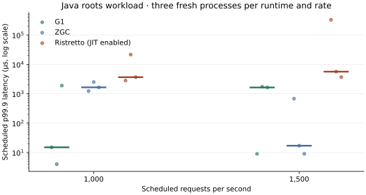

# Java roots latency with the primitive-array write change

At `3d882623`, all 18 processes finished every scheduled request, observed
collection, and produced the expected workload checksum for their rate.
Ristretto still had the highest median scheduled p99.9 latency at both rates.

| Scheduled requests/s | Completed per process | Ristretto with JIT | G1 | ZGC |
|---:|---:|---:|---:|---:|
| 1,000 | 10,000 | 3,648 µs | 15 µs | 1,648 µs |
| 1,500 | 15,000 | 5,632 µs | 1,632 µs | 17 µs |

The table takes the median of three fresh process-level p99.9 measurements.
At 1,500/s, Ristretto's individual scheduled tails were **327,680, 5,632
and 3,680 µs**. Service p99.9 in those processes was 1,440, 2,720 and
1,744 µs. The response histogram includes backlog relative to the scheduled
arrival time. A completed request count alone misses that delay.

Each process used the same Java classfiles and JDK, two assigned CPUs,
two CPUs of quota, two GC workers, 64 MiB of Java heap, a 512 MiB process
limit, five seconds of warmup and ten seconds of measurement. Launch order
was randomized on a shared host. These short runs compare the three runtimes
at fixed offered load. Quantifying the effect of the primitive writer on
Java needs a paired before/after JVM experiment. The [paired Rust writer
experiment](../../consolidated-collection-followups/primitive-writes/README.md)
measures that change directly at the mutator operation.

[All process outcomes](processes.csv) · [Raw histograms and cgroup limits](histograms.jsonl.gz) · [Build and workload identities](provenance.json)
