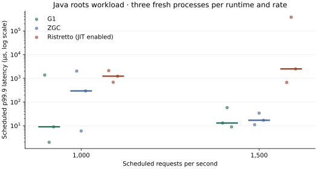

# Scheduled Java roots after the reference-card change

At `9a6e0f59`, three fresh processes per runtime and rate completed every offered request with the expected checksum. Each fork warmed up for five seconds and recorded ten seconds under a 64 MiB heap, a two-CPU quota, CPU affinity 4 and 6, and a 512 MiB RSS limit. Ristretto used its JIT-enabled benchmark configuration. G1 and ZGC ran on the same JDK. All 18 processes contributed to the table.

| Offered requests/s | G1 p99.9 µs | ZGC p99.9 µs | Ristretto p99.9 µs |
|---:|---:|---:|---:|
| 1,000 | 9 | 294 | 1,232 |
| 1,500 | 13 | 17 | 2,496 |

The table uses the median of the three per-process scheduled p99.9 values. The dots in the graph show all forks. At 1,500 requests/s the throughput comparison reached the offered ceiling on all runtimes. Sustainable capacity, three paired hour-long runs and the 24-hour soak remain open. An earlier 18-process screen overlapped a callback microbenchmark on the assigned CPUs. The complete schedule was repeated in isolation for these results.

[Per-process results](processes.csv), [histograms](histograms.jsonl.gz), [artifact hashes and controls](provenance.json).
