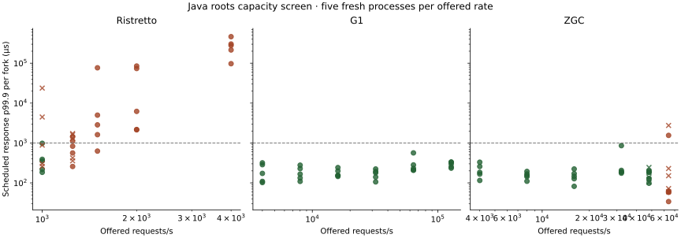

# Five-fork Java roots capacity search

At `cdee5888`, 105 fresh processes exercised the same Java classfiles. A rate passed when every fork completed all scheduled requests, scheduled p99.9 was at most 1 ms, the peak backlog represented at most 10 ms of arrivals, and at least 1,000 requests completed per fork.

| Runtime | Highest observed pass (requests/s) | Lowest observed failure (requests/s) | Search result | Both endpoints confirmed |
| --- | ---: | ---: | --- | --- |
| Ristretto | 1,000 | 1,000 | inconsistent | No |
| G1 | 128,000 | — | unbracketed | No |
| ZGC | 48,000 | 64,000 | bounded | Yes |

Ristretto passed the first five processes at 1,000/s. All five confirmation processes completed every request, but two exceeded the 1 ms response limit, recording 4.480 and 23.808 ms. This search could not establish a reproducible passing rate for Ristretto. G1 passed all five processes at the search ceiling of 128,000/s. Its upper limit remains unmeasured.

Each fork used five seconds of warmup and ten seconds of measurement with two pinned cores, a two-CPU quota, a 64 MiB managed heap and a 512 MiB process-group ceiling. The search started at 4,000 requests/s and allowed six exploratory points per runtime up to 128,000 requests/s. Where a pass and a failure bracketed a rate, both endpoints were rerun in five fresh forks. These short observations leave endurance, steady state, global pause attribution and p99.99 qualification open.

The dashed line marks the response-time limit. Circles show exploratory forks and crosses show confirmations. Green marks a passing five-fork point, red marks a failing point. A point can fail on backlog or unfinished requests even when a fork falls below the dashed line. [Individual forks](processes.csv) · [Arrival histograms, GC observations and memory](measurements.jsonl.gz) · [Inputs, limits and reasons for each point](provenance.json)

