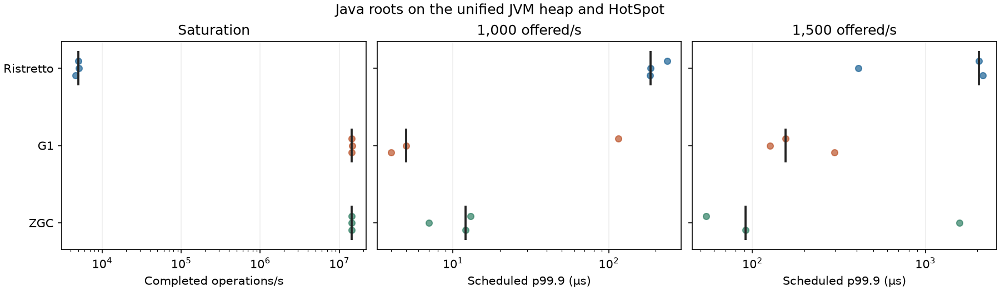

# Shipping JVM heap against HotSpot G1 and ZGC

At `880cce88` the Ristretto JVM ran 4,979 Java roots operations/s at saturation. G1 ran 14.42 million/s and ZGC ran 14.30 million/s on the same Java bytecode and host. Each operation constructs, publishes and traverses a 16-node list. The shipping `ristretto_gc` implementation ran with the comparison's candidate policy and native JIT enabled. The separate proposal to inline small instance fields is excluded from this build. [Field-storage experiment](../inline-instance-fields/README.md).

| Runtime | Saturated operations/s | Scheduled p99.9 at 1,000/s (µs) | Scheduled p99.9 at 1,500/s (µs) |
|---|---:|---:|---:|
| Ristretto | 4,979 (4,626–5,054) | 185 (184–238) | 2,032 (411–2,144) |
| G1 | 14,416,754 (14,301,273–14,605,990) | 5 (4–115) | 155 (126–298) |
| ZGC | 14,302,780 (14,244,231–14,350,979) | 12 (7–13) | 91 (54–1,568) |

Each cell gives the median and range over three fresh processes. All 27 processes passed the workload and retained-graph checks and observed GC activity. All 225,000 scheduled operations completed. Scheduled response includes waiting after the intended arrival. Its tail includes interpreter, scheduler, allocation and collection costs.

The measurement ran closed-loop or at a fixed arrival rate for ten seconds after five seconds of warmup. Each process had two CPUs, a two-CPU quota, a 64 MiB managed heap and a 512 MiB process memory ceiling with swap disabled. Reproduce with the [comparison command](../unified-heap-roots/README.md#reproduction) at `880cce88`, using seed `251128017`. All forks used release builds with method profiling and pause recording disabled. [Per-process results](processes.csv) · [Raw records and histograms](processes.jsonl.gz) · [JDK, source, build and resource identities](provenance.json).
