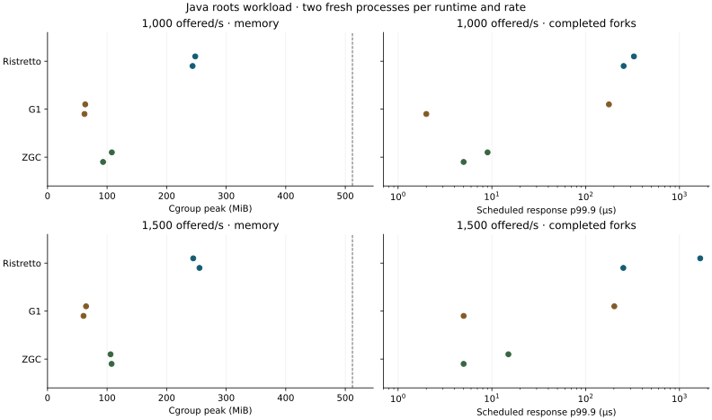

# Fixed-rate Java roots with synchronized-method ownership

At measured revision `480d279a`, Ristretto, G1 and ZGC completed all 60,000 or 90,000 scheduled requests in each fork. Each cell gives the median of the two fork percentiles. Requests ran for 60 seconds after five seconds of warmup with a 64 MiB managed heap, two CPU cores, a two-CPU quota and a 512 MiB process-group memory limit. Other development workloads were active on the host.

| Runtime | Offered per second | Scheduled p99.9 (µs) | Scheduled p99.99 (µs) | Peak memory across forks (MiB) |
| --- | ---: | ---: | ---: | ---: |
| Ristretto | 1,000 | 290.5 | 801 | 248.1 |
| Ristretto | 1,500 | 958 | 2373.5 | 255.2 |
| G1 | 1,000 | 89.5 | 208 | 63.3 |
| G1 | 1,500 | 103.5 | 149.5 | 64.7 |
| ZGC | 1,000 | 7 | 14.5 | 108.0 |
| ZGC | 1,500 | 10 | 151 | 107.6 |

At 1,500 requests/s the two Ristretto forks measured 252 and 1,664 µs at scheduled p99.9. These fixed rates characterize response time at the offered load. Sustainable capacity and host-wide pause qualification remain open. [Individual process results](processes.csv) · [Response histograms and resource samples](measurements.jsonl) · [Build and runtime provenance](provenance.json)

