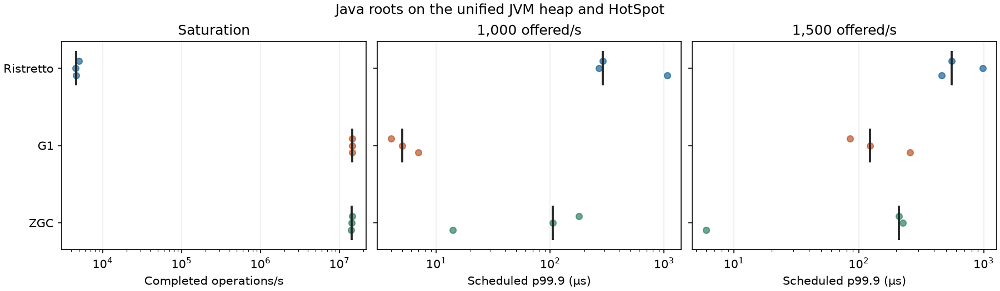

# Java roots on the unified heap, G1 and ZGC

Each operation allocates a 16-node list, publishes it into one of 2,048 array slots and traverses it to verify the values. All three runtimes ran the same Java bytecode on native Linux. Ristretto used the unified collector at `b65722a0` with its candidate policy and JIT enabled. G1 and ZGC used the HotSpot JIT in Corretto 25.0.5.

| Runtime | Saturated operations/s | Scheduled p99.9 at 1,000/s (µs) | Scheduled p99.9 at 1,500/s (µs) |
|---|---:|---:|---:|
| Ristretto | 4,596 (4,553–5,034) | 290 (268–1,072) | 557 (460–983) |
| G1 | 14,496,218 (14,450,605–14,566,934) | 5 (4–7) | 123 (85–256) |
| ZGC | 14,410,704 (14,156,898–14,458,887) | 106 (14–179) | 209 (6–226) |

Each cell shows the median and full range across three fresh JVM processes. Every fork passed its checksum and retained-graph checks. Across the 18 fixed-rate processes, **225,000 of 225,000** requests completed in the measurement windows. GC activity was observed over the process lifetime in 27 of 27 forks. Scheduled response includes time waiting after each request's intended arrival.



Each dot represents one process. Black bars mark medians. Higher throughput and lower latency are preferable. The horizontal scales are logarithmic.

## Measurement scope

Each process had five seconds of warmup and ten seconds of measurement, a 64 MiB managed heap limit, CPUs 4 and 6, a two-CPU quota, a 512 MiB process memory limit and no swap. Workload rates and runtime order were randomized within each of three repeats. The candidate policy uses context-local root storage (`RootStorage::Contexts`) and enables local allocation buffers, concurrent publication, independent marking and work stealing. The timing includes execution, allocation, barriers and collection. Method-entry profiling and GC pause recording were disabled for timing.

The scheduled forks offer 10,000 or 15,000 requests each. These short windows show the spread on this host. Sustained throughput, extreme-tail latency and GC-attributable pauses require separate measurements. The complete-collection comparison with frozen Ristretto uses the same candidate source and a different workload. [Complete-collection results](../../consolidated-collection-followups/terminal-dispatch-waits/README.md).

## Reproduction

From a clean checkout of `b65722a0`, use a writable delegated cgroup, two available CPUs, and JDK 25. Set `JDK_HOME` and `CGROUP_PARENT` to the local paths. This run used the release example with the default Cargo feature set.

```sh
cargo build --release --locked -p ristretto_vm --example gc_compare
python3 benchmarks/gc/run.py --jdk "$JDK_HOME" \
  --ristretto target/release/examples/gc_compare \
  --runtimes ristretto-candidate-jit g1 zgc --workloads roots \
  --rates 0 1000 1500 --seconds 10 --warmup 5 --repeats 3 \
  --heap-mib 64 --workers 2 --cpus 4 6 --cpu-quota 2 --rss-mib 512 \
  --cgroup-parent "$CGROUP_PARENT" --timeout 100 --seed 251127479 \
  --output /tmp/unified-java-roots
```

[Per-process rates and percentiles](processes.csv) · [Full measurements, histograms, checksums and enforced budgets](processes.jsonl.gz) · [Binary, JDK and source identities](provenance.json).
