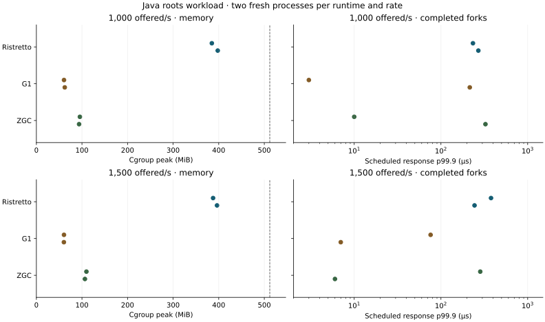

# Java roots workload on the consolidated collector

All three JVMs completed every scheduled request in 12 fresh forks. At both arrival rates G1 and ZGC had lower median scheduled p99.9 latency than the consolidated Ristretto JVM at `280ad63d`.

| Runtime | p99.9 at 1,000/s (µs) | p99.9 at 1,500/s (µs) | Highest cgroup memory (MiB) |
| --- | ---: | ---: | ---: |
| Ristretto | 252 | 311 | 397.9 |
| G1 | 109 | 41.5 | 62.3 |
| ZGC | 168 | 145 | 109.8 |

The harness randomized two 60-second forks per runtime and rate after a five-second warmup, with the same classes and JDK modules, a 64 MiB managed heap, two CPUs, a two-CPU quota and a 512 MiB cgroup memory limit. Each fork completed 60,000 or 90,000 requests. The graph shows both forks so that their variation remains visible.

These fixed arrival rates measure latency under the offered load. Maximum sustainable throughput, global mutator pause durations, and sustained-load qualification remain open. The complete-collection benchmark uses a separate workload and baseline. [Collection results](../consolidated-complete/README.md)

[Ordered fork results](processes.csv) · [Histograms, memory observations and output digests](measurements.jsonl) · [Build and run provenance](provenance.json)
