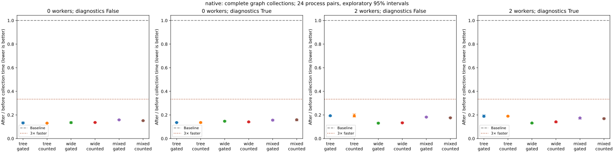
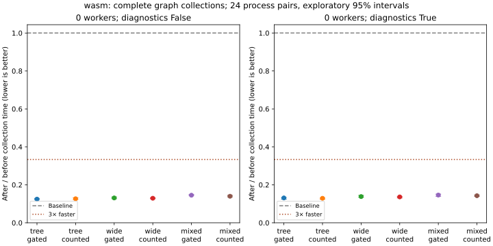

# Fivefold complete-collection measurements

The reviewed collector at 0d353249 clears the 5× median target in all 36 conditions against f1daebeb. Each target used the same collector fixture and build inputs in both arms. Every fresh process verified reachability, completed cycles, physical refunds and final reclamation.

| Target | Conditions | Weakest paired speedup | Weakest 95% lower bound | Lower bounds above 5× |
| --- | ---: | ---: | ---: | ---: |
| Native, zero or two workers | 24 | 5.17× | 4.80× | 22/24 |
| WASI, cooperative | 12 | 6.85× | 6.63× | 12/12 |

The native uncertainty is concentrated in two-worker tree runs. The earlier integrated build with a different reader-admission instruction reached 5.18× and 7.00× minimum medians, with all 36 lower bounds above 5×. Both campaigns are reported separately. [Reviewed process pairs](processes.csv) · [Earlier process pairs](pre-review-processes.csv) · [Per-condition estimates](summary.json) · [Build provenance and binary hashes](provenance.json)

Each campaign randomized 24 fresh-process pairs per condition, totalling 1,728 processes per campaign. Each process timed 16 complete collections on a 4,095-node tree, wide graph or mixed heap after three warmups. The mixed case added 1,023 fresh dead scalars per cycle. The matrix includes gated and counted publication and diagnostics on and off. The intervals resample process pairs within each condition and have no multiple-comparison correction. Native workers shared the specified CPU set. WASI ran under the recorded Wasmtime build. The timing includes marking and physical reclamation and excludes fixture setup and teardown. Application latency, sustained-load behavior and GC-attributable pauses require separate qualification.

