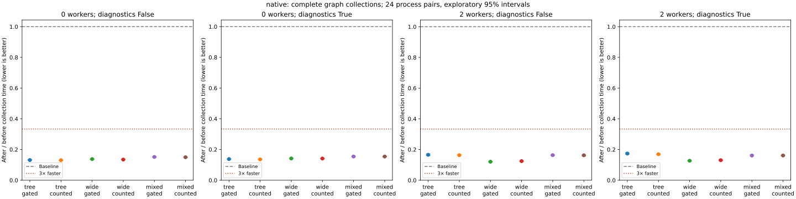
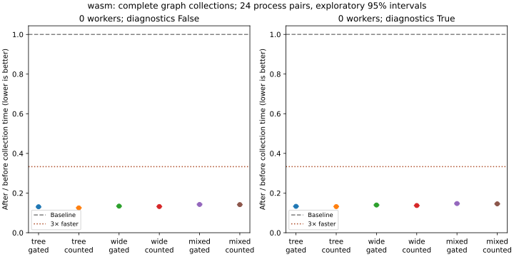

# Complete collections with concurrent host reference publication

The integrated collector at `53897798` includes fresh host weak-reference publication, late retaining-reference processing and peer mark lanes. Each measurement times 16 complete collections of a 4,095-node heap. The control is `f1daebeb`. Both arms use the same fixture, dependency lock, build profile and CPU set within each pair.

| Runtime | Conditions | Process pairs per condition | Slowest paired median speedup | Lowest per-condition 95% lower bound |
| --- | ---: | ---: | ---: | ---: |
| Native | 24 | 24 | 5.76× | 5.59× |
| WASI | 12 | 24 | 6.80× | 6.68× |

The intervals are paired bootstrap intervals for individual conditions. This campaign measures collector wall time on live trees, wide graphs and trees with newly allocated garbage. Application latency and global pause duration require separate measurements.

[Raw process measurements](processes.csv) · [Condition summaries](summary.json) · [Build and runner provenance](provenance.json)
