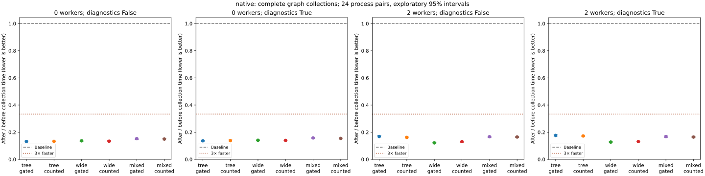
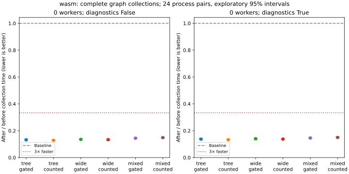

# Complete collection after numeric root deletion and old-generation tracing changes

The integrated collector at `92906c66` clears 5× versus `f1daebeb` in all 36 conditions. Each of the 1,728 fresh processes completed 16 full collections with exact heap-content and physical-refund checks. This integration includes pending reference FIFO progress, detached numeric root deletion and exact old-callback edge handoff.

| Target | Conditions | Pairs per condition | Lowest median speedup | Lowest individual 95% lower bound |
| --- | ---: | ---: | ---: | ---: |
| Native | 24 | 24 | 5.67× | 5.53× |
| WASI | 12 | 24 | 6.68× | 6.46× |

The pair shares its workload, build profile, compiler, dependencies and CPU assignment. Runs cover 4,095-node trees, wide graphs and trees with 1,023 fresh dead scalars per collection, both publication policies and both diagnostics settings. Native used zero or two background workers. WASI used cooperative collection. The paired bootstrap intervals are per condition with no multiple-comparison correction.

These measurements time complete collections. Scheduled Java response time, browser host-turn gaps and all-mutator pauses require separate observations.

[Individual process measurements](processes.csv) · [Per-condition estimates](summary.json) · [Source and binary provenance](provenance.json)
