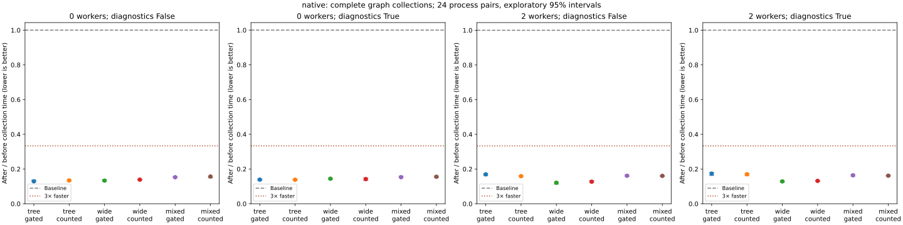
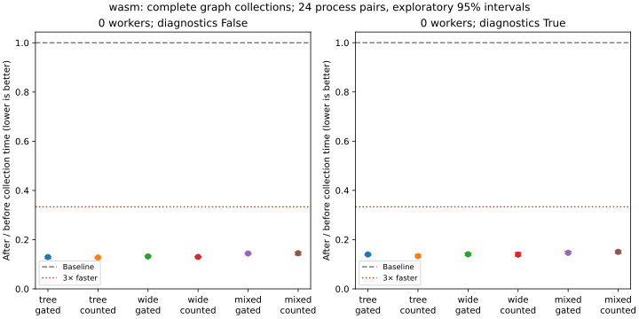
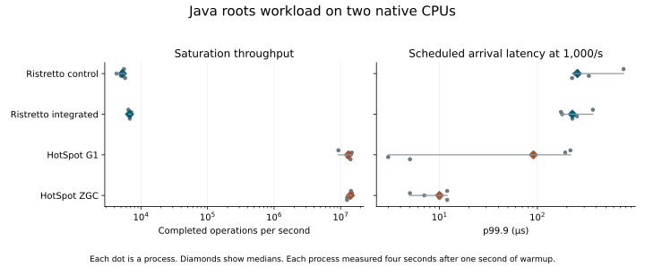

# Full collections and native Java roots

The integrated collector completed the 4,095-node fixture at least **5.77× faster on native** and **6.65× faster on WASI** than the original control. These are the lowest paired medians across 24 native and 12 WASI conditions. The lowest per-condition bootstrap 95% lower bounds were 5.56× and 6.44×. The intervals are exploratory and have no multiple-comparison adjustment.

Each condition ran 24 randomized before/after process pairs, 1,728 processes in total. Each process measured 16 complete full collections after three warmup cycles. The matrix includes the live tree, wide graph and mixed live/dead graph, both publication policies and both diagnostics settings. Native used zero or two background workers. WASI used cooperative collection. The fixture checked liveness and physical reclamation. Wall time includes collection waits and excludes graph setup and teardown.

The measured GC sources match the integration at `50deac3b`. The original control is `f1daebeb`. Both used the same fixture and dependency manifests from `9f1517e9`. Binary and source hashes, process order and paired intervals accompany the figures. [Process measurements](processes.csv) · [Paired results](summary.json) · [Collector provenance](provenance.json)

## Native application comparison

On an earlier snapshot of the same stack, before peer-lane batching, the Java roots workload showed the following process medians. Two CPUs, a two-CPU quota, a 64 MiB managed heap and a 512 MiB cgroup with zero swap applied to each process. Ristretto used its ordinary JIT mode and two GC workers. HotSpot used Corretto 25.0.5 and its default JIT. Each condition used five fresh processes, one second of warmup and four seconds of measurement.

| Runtime | Saturated operations/s | Scheduled p99.9 at 1,000/s |
| --- | ---: | ---: |
| Ristretto control | 5,269 | 256 µs |
| Ristretto integrated | 6,730 | 227 µs |
| HotSpot G1 | 13,141,872 | 91 µs |
| HotSpot ZGC | 14,026,419 | 10 µs |

All 40 processes passed workload checksum and histogram validation. Each runtime completed every scheduled arrival at 1,000/s. Collection activity was observed over each process lifetime, which included startup and warmup. These short runs measure application throughput and latency. They leave measured-window GC attribution, long-run tails and absence of global pauses open.

The per-process export includes completion counts, histogram quantiles, elapsed time, CPU, peak RSS and checksum. The control build used a modified worktree. Its archived per-file source hashes and executable hash identify the measured inputs more precisely than its Git HEAD alone. [Java process measurements](java-processes.csv) · [Java build identities and resource settings](java-provenance.json)
