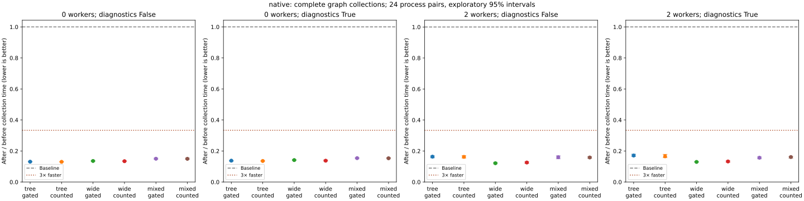
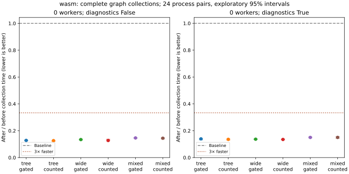

# Complete collection after field and reference progress fixes

The integrated collector at `0ca5947b` includes the field publication, root enumeration, weak clone and retaining-reference changes. Against `f1daebeb`, all 36 conditions cleared 5× on both the paired median and the individual 95% lower bound.

| Runtime | Conditions | Pairs per condition | Lowest median speedup | Lowest per-condition 95% lower bound |
| --- | ---: | ---: | ---: | ---: |
| Native | 24 | 24 | 5.86× | 5.57× |
| WASI | 12 | 24 | 6.66× | 6.43× |

Each of 1,728 fresh processes measured 16 full collections of 4,095-node live trees, wide graphs or trees with fresh dead allocations. Both arms used the same build profile, dependencies, fixture and CPU set within each pair. Diagnostics and publication policy vary across conditions. Native includes zero and two background workers. WASI uses cooperative collection. Bootstrap intervals have no multiple-comparison adjustment.

Measured wall time includes collection completion and checked physical reclamation. The fixture supplies no Java application latency or all-mutator pause timing.

[Process measurements](processes.csv) · [Per-condition summaries](summary.json) · [Sources and build provenance](provenance.json)
