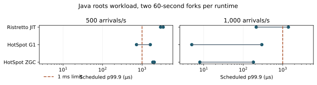

# Native Java roots at fixed arrivals

Two independent 60-second processes per runtime and rate exercised the same Java program, with five seconds of warmup, two CPUs, a two-core quota, 64 MiB managed heap and a 512 MiB memory limit with swap disabled. Each process completed all 30,000 or 60,000 scheduled operations. Ristretto used its ordinary JIT and two collector workers. The measured Ristretto JVM is the integrated executable identified in the [short paired comparison](../peer-lanes/README.md).

| Arrivals/s | Ristretto scheduled p99.9 (µs) | G1 scheduled p99.9 (µs) | ZGC scheduled p99.9 (µs) |
| ---: | ---: | ---: | ---: |
| 500 | 3,424 / 2,944 | 1,616 / 724 | 1,872 / 2,032 |
| 1,000 | 1,392 / 214 | 296 / 5 | 8 / 181 |

At 1,000/s both HotSpot runtimes met the 1 ms p99.9 limit in both forks. Ristretto exceeded it once. At 500/s every runtime exceeded it in at least one fork. Every fork satisfied the 10 ms peak backlog and 10,000-completion limits. Neither rate passed across all runtimes. These two rates establish no common capacity or long-duration qualification.

The workload measures time from each scheduled arrival to completion. Its arrival loop sleeps for whole milliseconds when at least one millisecond remains, then yields near the deadline. Service latency excludes that wait. At 500/s, the two G1 service p99.9 values were 8 and 6 µs. Both were far below their corresponding scheduled latencies. The data cannot attribute the difference to a particular collector. Collection counters include startup, warmup and output.

[Individual processes](processes.csv) · [Gate decisions](criteria.json) · [Source, binary and resource identities](provenance.json)
