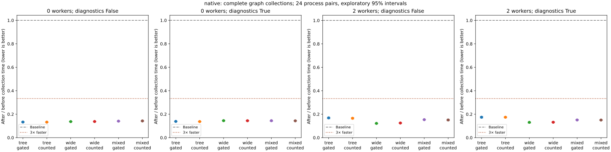
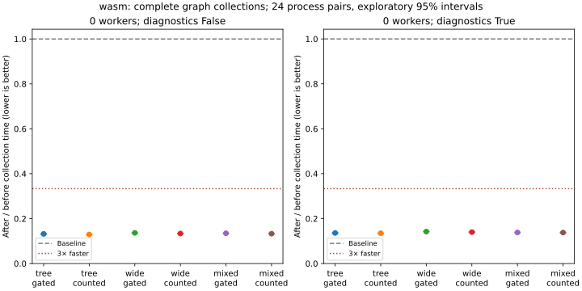

# Complete collection after white-object transfers and cycle probe changes

The collector at `d623c73d` cleared the 5× gate against `f1daebeb` in all 36 conditions. The lowest native median came from the two-worker counted tree with diagnostics enabled. The lowest WASI median came from the gated wide graph with diagnostics enabled.

| Target | Conditions | Pairs per condition | Lowest median speedup | Lowest individual 95% lower bound |
| --- | ---: | ---: | ---: | ---: |
| Native | 24 | 24 | 5.75× | 5.55× |
| WASI | 12 | 24 | 7.04× | 6.99× |

All 1,728 fresh processes completed 16 timed collections and verified the live graph checksum and zero remaining bytes at teardown. Mixed cycles additionally verified the physical refund for all 1,023 dead scalars. Each pair used the same frozen fixture, host CPU assignment, compiler, profile and dependency lock. The compiler reported fresh library and example artifacts in a separate target for each binary. The per-condition intervals use the paired bootstrap. Twenty-two lower bounds crossed 7×. The 10× target remains open in every condition on this release stack.

Application response time and mutator pauses have separate experiments. [Process records](processes.csv) · [Paired estimates](summary.json) · [Compiler, source and binary provenance](provenance.json)
