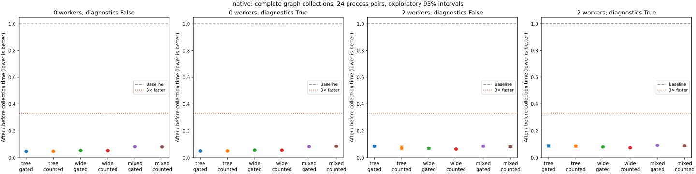
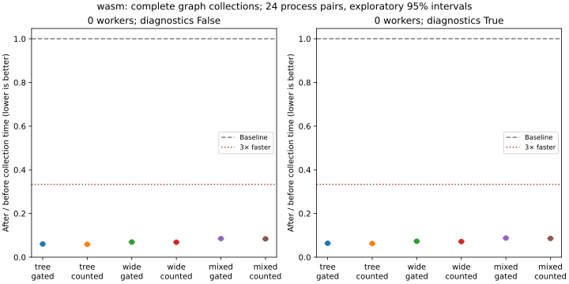

# Tenfold complete-collection qualification

Every individual 95% lower confidence bound exceeded 10× against the original Ristretto collector on this host. The frozen collector uses reusable groups of exact mature descriptors. An eligible full mark claim calls each user tracer with its assigned budget directly from the group. The timed mixed collections include clearing and physically refunding each dead allocation.

| Target | Conditions | Lowest paired median | Lowest individual 95% lower bound |
| --- | ---: | ---: | ---: |
| Native, caller and zero or two background workers | 24 | 10.98× | 10.23× |
| WASI, caller only | 12 | 11.44× | 11.34× |

All 1,728 fresh processes passed, completing 27,648 timed full collections with 4,095 live nodes each. Every mixed cycle added 1,023 unreachable scalars. Each process checked the live graph checksum and finished with zero live objects and zero managed bytes. The slowest native median was the gated mixed workload with diagnostics on and two workers. The lowest native bound came from the gated tree with the same worker and diagnostics settings. The weakest WASI condition was gated mixed with diagnostics on.

Every condition had 24 fresh randomized pairs using confirmation seed 11890403 after the exploratory screens. Each bootstrap interval is individual. The runner checked the actual schedule, binary hashes and unchanged build inputs. Isolated builds of the published source reproduced the exact bytes of both measured executables. The public source branch freezes the experimental implementation and its workspace resolution. The production review stack and whole-JVM pause measurements are separate release gates.





[Ordered process records](processes.csv) · [All paired intervals](summary.json) · [Build, CPU, toolchain and runner provenance](provenance.json)

## Reproduction

Use a fresh directory, the toolchain in the checkout and the Wasmtime version in the provenance. The two checkouts share the fixture and workspace lock. Restore the original collector source in the control checkout only. The isolated builder from PR #1230 verifies fresh Cargo artifacts.

```sh
git fetch origin gc-alpha/address-benchmark-screen bench/tenfold-collector-source-v1 gc-alpha/isolated-collection-builds-v1
run=$(mktemp -d)
git worktree add --detach "$run/after" a3fef08caa8ccc9faa8f063ad803a9d9af1e68d0
git worktree add --detach "$run/before" a3fef08caa8ccc9faa8f063ad803a9d9af1e68d0
git -C "$run/before" restore --source=f1daebeb277323fa0d5e732ae3853db6b97eac8b --staged --worktree -- ristretto_gc/src
git worktree add --detach "$run/tools" 75748590
for target in native wasm; do
  for arm in before after; do
    python3 "$run/tools/benchmarks/gc/mark_cycles_build.py" --build --target "$target" \
      --source "$run/$arm" --binary "$run/$arm-$target.bin" --output "$run/$arm-$target.json"
  done
done
python3 "$run/after/benchmarks/gc/mark_cycles.py" --before-build "$run/before-native.json" \
  --after-build "$run/after-native.json" --output "$run/native" --cpus 0 2 8 --workers 0 2 \
  --shapes tree wide mixed --nodes 4095 --cycles 16 --repeats 24 --seed 11890403
python3 "$run/after/benchmarks/gc/mark_cycles.py" --before-build "$run/before-wasm.json" \
  --after-build "$run/after-wasm.json" --output "$run/wasm" --wasmtime "$(command -v wasmtime)" \
  --cpus 10 --workers 0 --shapes tree wide mixed --nodes 4095 --cycles 16 --repeats 24 --seed 11890403
```
