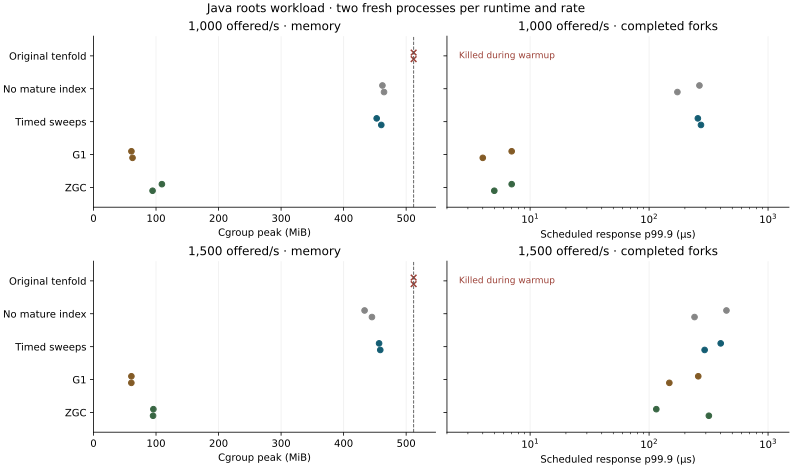

# Java roots under a 512 MiB limit

The first tenfold collector exhausted the 512 MiB cgroup in all four Ristretto JVM forks during the five-second warmup. The kernel recorded one OOM kill per process. Two follow-up implementations completed all 60,000 and 90,000 scheduled arrivals per fork under the same limit.

| Runtime or collector | Scheduled p99.9 at 1,000/s (µs) | Scheduled p99.9 at 1,500/s (µs) | Peak cgroup memory across forks (MiB) |
|---|---:|---:|---:|
| Ristretto, first tenfold collector | Died in warmup | Died in warmup | 512 |
| Ristretto, mature index removed | 265 / 173 | 447 / 241 | 464.6 |
| Ristretto, index omitted for deadline-limited sweeps | 257 / 273 | 400 / 293 | 460.2 |
| HotSpot G1 | 7 / 4 | 259 / 148 | 62.4 |
| HotSpot ZGC | 7 / 5 | 115 / 318 | 109.4 |

The initial randomized campaign interleaved Ristretto, G1 and ZGC. Each follow-up ran as a separate campaign on the same CPUs (4 and 6), with two workers, a 64 MiB managed heap, a two-CPU quota, zero cgroup swap and seed 140913. Java warmup runs without an arrival-rate cap. G1 and ZGC had lower median scheduled p99.9 at both rates. Each successful process had fewer than one million completions. Global mutator pause durations were unavailable.

The deadline-limited sweep selects one address entry, so its mature survivor index is unused. Deleting the index in all modes missed the separate native tenfold complete-cycle gate (minimum median 9.90×, lowest individual 95% bound 9.43×). Restricting the index to batched sweeps preserved that gate at experimental source de943ebf. In 24 randomized pairs per condition, with seed 8210693, the native minimum median was 10.60× and its lowest bound was 10.20×. WASI reached 11.77× and 11.62×. Those timings compare full collection cycles to f1daebeb. The Java results above measure end-to-end service.

The CSV includes all 20 fresh processes, including the four warmup failures. Each JSONL row retains its output digests, cgroup counters, memory samples and the original measurement with histograms when available. Provenance identifies each immutable JVM binary, source archive, Java class files, JDK modules and driver revision.

[Process results](processes.csv) · [Histograms and memory samples](measurements.jsonl) · [Build and run provenance](provenance.json)
