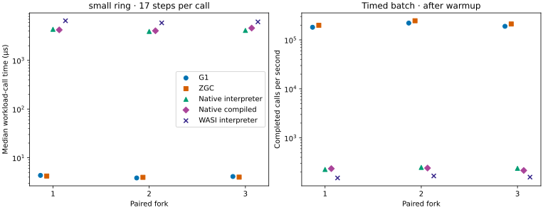
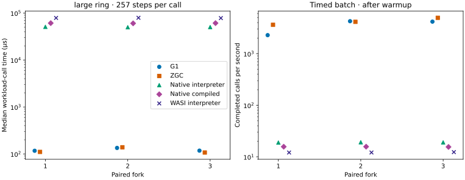

# Finite Java ring comparison

Measured source [`449a2ee81c5d`](https://github.com/theseus-rs/ristretto/commit/449a2ee81c5dfe06b674f6165bc9372994b510bb). Both classfiles were identical across all five execution modes. Each fork started a fresh process, warmed up with eight calls, then reused the same heap for the timed batch. The small ring retained eight nodes with 64–88 byte payload arrays and ran 17 steps. The large ring retained 128 nodes with 4,096–4,480 byte payload arrays and ran 257 steps. Each Ristretto tier checked its allocation count on every timed call (50 small, 770 large).

| Execution | Small call (µs) | Small calls/s | Large call (µs) | Large calls/s |
| --- | ---: | ---: | ---: | ---: |
| G1 | 4.12 | 189,292.36 | 117.45 | 4,177.51 |
| ZGC | 4.00 | 211,104.07 | 110.39 | 4,138.04 |
| native-interpreted | 4,121.49 | 238.64 | 50,288.62 | 19.06 |
| native-compiled | 4,228.74 | 235.41 | 60,978.75 | 15.70 |
| wasi-interpreted | 6,177.18 | 157.86 | 78,698.36 | 12.14 |

Call time is the median of three per-process median workload-call times. Calls/s is the median of three per-process completion rates. Each small process completed 12 timed calls and each large process completed 48. The measurement includes application, VM and collector work inside the timed batch. A collection bean records activity over the batch and does not attribute an individual call to a GC pause.





[Small raw samples](small.json) · [Small per-process table](small.csv) · [Large raw samples](large.json) · [Large per-process table](large.csv)

## Collection activity

| Large-ring collector bean | Fork 1 | Fork 2 | Fork 3 |
| --- | ---: | ---: | ---: |
| G1 Young Generation | 3 | 3 | 3 |
| G1 Concurrent GC | 0 | 0 | 0 |
| G1 Old Generation | 0 | 0 | 0 |
| ZGC Minor Cycles | 4 | 3 | 3 |
| ZGC Minor Pauses | 12 | 9 | 9 |
| ZGC Major Cycles | 3 | 3 | 3 |
| ZGC Major Pauses | 11 | 12 | 12 |

ZGC can report cycle and pause beans for the same collection. The raw files also give each bean’s accumulated collection time. Ristretto records allocation, release and helper-poll counts for every timed invocation. Each native and WASI process verified its final managed-payload and catalog-credit refund.

## Environment

13th Gen Intel(R) Core(TM) i7-13700T, Linux 7.0.0-38-generic (x86_64), affinity to logical CPUs 8 and 10 on different physical cores. All five modes ran on the same shared development host. Each process inherited a two-CPU quota and a 1 GiB memory ceiling. HotSpot used a 64 MiB fixed Java heap. Ristretto had a 64 MiB payload limit plus bounded object, root and edge counts. The JSON contains effective limits, JVM flags, runtime and Java classfile hashes and the source revision.

Capture window 2026-11-21T18:26:36.958040+00:00 through 2026-11-21T18:27:15.804294+00:00. openjdk version "25.0.5" 2026-10-20 LTS, wasmtime 50.0.1 (c307ec81d 2026-10-29), rustc 1.99.1 (58cf8f9c3 2026-10-13). The SVG and CSV were independently regenerated twice with Matplotlib 3.11.2 and matched byte-for-byte.

The two finite workloads characterize these binaries and settings. Establishing sustainable throughput, GC pause percentiles or a global-pause guarantee requires separate evidence. [Build and capture commands](../../README.md)

## Reproduce the measured configuration

Check out the measured revision and build both release binaries using the commands in the [ring guide](../../README.md). Put the recorded HotSpot JDK and Wasmtime on PATH. These commands use the same CPU affinity and cgroup limits as the archived run.

```sh
capture() {
  systemd-run --user --scope --quiet -p MemoryMax=1G -p CPUQuota=200% taskset --cpu-list 8,10 \
    python3 benchmarks/gc/ring/compare.py "$1.json" --workload "$1" --steps "$2" --samples "$3" \
    --warmup 8 --forks 3 --revision "$(git rev-parse HEAD)" \
    --native target/release/examples/canonical_ring_samples \
    --compiled target/release/examples/canonical_ring_samples \
    --wasi target/wasm32-wasip2/release/examples/canonical_ring_samples.wasm \
    --wasmtime "$(command -v wasmtime)"
}
capture small 17 12
capture large 257 48
```

Generate both graphs and CSV files with `python3 benchmarks/gc/ring/report.py small.json small.csv small.svg` and the corresponding command for `large.json`. Each point corresponds to one process.
